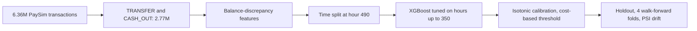
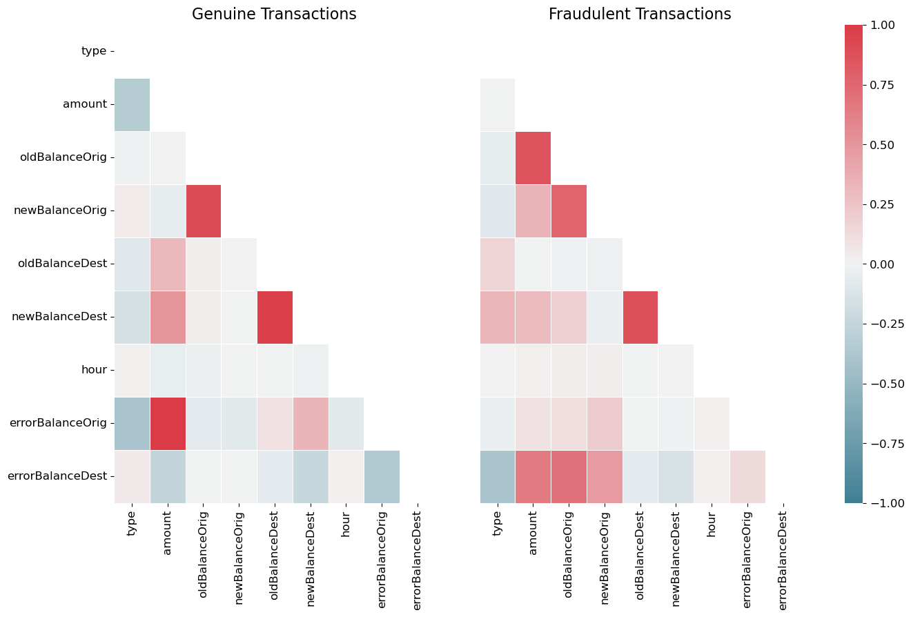

# Fraud Detection System: stopping mobile-money fraud before the money leaves

**A calibrated XGBoost model that flags fraudulent mobile-money transfers so they can be stopped before the
money leaves. Trained on 6.36 million simulated PaySim transactions and tested on 132,136 later ones it had
never seen, it stopped 99.98% of the fraud value (the simulator's built-in flag stopped 1.1%), catching 2,742
of 2,754 frauds while wrongly freezing 3 honest customers. Walk-forward validation over four later windows, a
live scoring API and 56 tests in CI.**

[](LICENSE)
[](https://www.python.org/)
[](https://github.com/alvenyuka/Fraud-Detection-System/actions/workflows/ci.yml)

**Try it:** [live scoring page](https://fraud-detection-alven.vercel.app), which scores with the shipped model.
The Streamlit dashboard runs locally (`make dashboard`); its public host was retired.


## The problem

In mobile money a fraud flag usually freezes the customer's funds. Every false alarm locks an honest customer
out of their own money; every missed fraud is a direct loss. Fraud is about 0.13% of transactions, so a model
that never flags anything is 99.87% accurate and useless. A fraud-operations team needs three answers: **how
much fraud value the model stops, how many honest customers it freezes to do so, and whether that holds as
time passes.**

## How it works



1. **Filter.** Only TRANSFER and CASH_OUT carry fraud in PaySim, leaving 2,770,409 transactions.
2. **Features.** Five numbers per transaction: the amount, whether the sender's and the recipient's balances
   moved by exactly the amount sent, how much of the sender's balance the transfer drains, and the amount
   relative to the recipient's balance. Fraud breaks the accounting identity.
3. **No look-ahead.** Training data precedes test data. Hyperparameters are tuned with Optuna (40 trials) only
   on windows ending by hour 350, before every reporting window, and the model ships with the tree count early
   stopping chose in tuning (35 trees).
4. **Calibration and a cost-based cut-off.** Isotonic calibration on the latest fifth of the training hours
   (393 to 490), then the threshold that minimises cost with a missed fraud priced at 100 times a false alarm.
5. **Validation over time.** The holdout, plus four expanding-window folds testing hours 351 to 743, each
   choosing its threshold on calibration data, never on test rows.
6. **Serve and monitor.** A pure-Python port of the model behind the live API, parity-tested against the
   original; Population Stability Index for each balance feature across 15 time windows.

## Stack

| Layer | Tool | Version |
|---|---|---|
| Language | Python | 3.13; CI on 3.12 and 3.13 |
| Data | pandas, NumPy, SciPy | 3.0.3, 2.4.6, 1.17.1 |
| Model | XGBoost, scikit-learn (isotonic calibration) | 3.3.0, 1.8.0 |
| Tuning | Optuna | 4.9.0 |
| Explainability | SHAP | 0.51.0 |
| Comparisons (notebook only) | LightGBM, imbalanced-learn | 4.6.0, 0.14.2 |
| Charts | matplotlib, seaborn, Plotly | 3.9.2, 0.13.2, 6.9.0 |
| Serving | serverless Python API on Vercel (`api/score.py`), Streamlit dashboard | |
| Tests and CI | pytest, GitHub Actions | 8.3.3 |

`requirements-lock.txt` pins every transitive dependency; `src/predict.py` warns when the installed
scikit-learn or XGBoost differ from the versions the model was trained with.

## Results

- 6,362,620 transactions in the simulation; 2,638,273 in the training period (steps 1 to 490).
- 132,136 held-out transactions (steps 491 to 743) with 2,754 frauds, scored once.
- 4 walk-forward folds and 15 drift windows.
- 56 tests pass, with no dataset needed.

| Measure | Result |
|---|---:|
| Frauds caught on the holdout (recall) | **2,742 of 2,754, 99.6%** |
| Flags that were fraud (precision) | **99.9%**, 3 false alarms |
| PR-AUC on the holdout | 0.9984 |
| Brier score (calibration) | 0.000131 |
| Operating threshold (cost-optimal on calibration data) | 0.8852 |
| Walk-forward PR-AUC, 4 later windows | 0.9971 ± 0.0020 |
| Walk-forward precision / recall | 96.9% / 99.7% |

Ranking holds steady; the cut-off does not. Walk-forward precision is lower and less stable than the holdout
figure: the last fold chose a threshold of 0.021 on its calibration data and reached 88.1% precision. Across
the folds the cost-optimal threshold ranged from 0.021 to 1.00 (coefficient of variation 0.57), and
`orig_drain_ratio` reached a PSI of 0.76 against the training window in the final hours. A deployment would
review the threshold on a schedule, and the dashboard's monitoring tab tracks the drift.

## Business impact

Value of fraud on the holdout, in PaySim's simulated currency units, where a fraud's value is its transaction
amount. Produced by `src/business_impact.py`.

| Screening | Fraud value stopped | Fraud value let through | Honest customers frozen |
|---|---:|---:|---:|
| None | 0 | 4.19 bn | 0 |
| PaySim's `isFlaggedFraud` flag | 46.5 M (1.1%) | 4.14 bn | 0 |
| **Model, threshold 0.8852 (cost-optimal)** | **4.190 bn (99.98%)** | 0.75 M | 3 |
| Model, threshold 0.5 | 4.190 bn (99.98%) | 0.75 M | 3 |

The model stops 90 times as much fraud value as the built-in flag. On this holdout any cut-off from 0.5 up to
the cost-optimal 0.8852 gives the same result: 2,742 frauds caught and 3 honest customers frozen, so there is no
trade-off to price and `src/business_impact.py` reports the break-even cost per freeze as undefined. The
calibrated model gives only a handful of distinct scores, so the cut-off matters only where it crosses one of
them: above 0.88, recall drops to 95.0% (`dashboard/data/threshold_cost_curve.csv`). Assumption: a missed fraud
costs 100 times a false alarm.

## Charts


*Left: the holdout is flat across a wide band of thresholds. Right: across later windows ranking stays near
0.997 PR-AUC while precision moves, which is why the threshold needs a review schedule.*



*In genuine transactions the balances move together; in fraud they do not. That broken identity is the
signal the features are built on.*

## Data

| Source | Link | Terms | Size | Period | Refresh |
|---|---|---|---:|---|---|
| PaySim (Lopez-Rojas, Elmir and Axelsson, 2016) | [Kaggle](https://www.kaggle.com/datasets/ealaxi/paysim1) | Kaggle dataset licence | 6,362,620 transactions | 743 simulated hours | static |

PaySim simulates mobile money from the logs of an African service, one row per transaction and one step per
simulated hour. Fraud is 0.13% of all transactions; the training period runs at 0.21% and the holdout at 2.08%.
The CSV is not committed; download it into `data/`.

## Key design decisions

- **A time split, not a random one.** Fraud patterns move; a random split would let the model see the future.
  Training stops at hour 490 and tuning at hour 350, before every reporting window.
- **A threshold from costs, not 0.5.** The cut-off minimises cost with a missed fraud priced at 100 times a
  false alarm, chosen on calibration data only, so the holdout is never used to tune it.
- **Five balance features over the raw balance columns.** Testing the live demo showed an earlier model
  scoring a customer emptying their own account as certain fraud, because it read "balance hits zero" from the
  raw columns. They were removed in favour of ratio and identity features.
- **Isotonic calibration.** A frozen-customer decision needs a probability, not just a rank; the Brier score
  of 0.000131 shows the calibrated scores can be read that way.
- **A pure-Python port for the live API.** The serverless function cannot load the full ML stack, so the model
  is exported to JSON and re-implemented in `api/score.py`, with a test proving both give the same scores.

## Limits

- **The shortcut is only partly fixed.** `orig_drain_ratio` still encodes a full drain, and the shipped model
  scores a fully consistent full drain at 90.2% and a 12-unit one at 88.5%, both flagged
  (`dashboard/data/scenario_table.json`). `MODEL_CARD.md` explains why this is a property of PaySim's labels.
- **Full-drain fraud only.** Fraud here has one signature: the sender's account is drained to zero. The two
  sender-side features carry 77% of the model's SHAP attribution, and a fraud that moves half an account with
  nothing credited to the recipient scores 0.0000%. A rule-based patch for partial skims was tested on an
  earlier model and rejected because it multiplied false alarms on the training period.
- **PaySim is a simulator.** Once these features exist its fraud is almost deterministic, which is why the
  scores are so high. In the notebook a random forest reaches PR-AUC 1.0000 on the holdout and a class-weighted
  XGBoost 0.9989. The evaluation method carries over to real data; the score does not.
- **The holdout is fraud-heavy** (2.1% against 0.30% for TRANSFER and CASH_OUT over the whole simulation), and
  precision depends on that mix. At the whole-simulation rate the model would raise about 23 false alarms per
  million screened transactions and keep 99.2% precision (`precision_at_real_fraud_rate` in
  `dashboard/data/business_impact.json`).
- **Money figures are simulated units**, and the cost of a false alarm is an assumption, not a measurement.

## Project structure

```
src/            features, tuning, training, walk-forward validation, monitoring, SHAP, scenarios,
                business_impact.py (value stopped by each screen), make_figures.py
api/score.py    pure-Python port of the model behind the live demo, parity-tested
dashboard/      Streamlit dashboard and the precomputed results it reads
model/          trained model, tuned settings, JSON export
tests/          56 tests: time split, both fixed leaks, accounting identity, threshold, PSI, API, port parity
MODEL_CARD.md   intended use, evaluation, limitations
docs/           METHODOLOGY.md: tuning, walk-forward details, drift findings, the tests
Fraud_Detection_System.ipynb   the analysis in four parts, executed end to end;
                               charts in figs/, numbers in outputs/notebook_results.json
```

The notebook is the analysis behind the pipeline: what the data can support (two real frauds worked through,
the ledger rule turned into features, a leakage guard and a time split), which transfers are fraudulent (a
two-question tree, XGBoost, four model families, SMOTE against class weights, SHAP), what it is worth, and
limits. Its scores come from its own wider feature set, not the shipped model.

## How to run

```bash
pip install -r requirements.txt   # exact pins; requirements-lock.txt pins everything
make test        # 56 tests, no dataset needed
# download PaySim from Kaggle into data/, then:
make tune        # 40 Optuna trials; the recorded run took 4 hours on a shared machine
make train       # train and save the model, about a minute
make validate    # four walk-forward folds
python src/business_impact.py --data data/PS_20174392719_1491204439457_log.csv
make figures     # redraw the README charts
```

## Skills demonstrated

- Feature engineering from accounting identities: `src/` features
- Leakage control with a strict time split and tuning windows that end before reporting: `src/`, `tests/`
- Hyperparameter search with Optuna and early stopping: `src/`, `model/`
- Probability calibration and a cost-based decision threshold: `src/train.py`
- Walk-forward validation and PSI drift monitoring: `src/`, the dashboard's monitoring tab
- Explainability with SHAP for every scored transaction: the dashboard
- Serving a model as a serverless API with a parity-tested port: `api/score.py`
- Reporting results in money and in honest customers frozen: `src/business_impact.py`

## License

MIT. See [`LICENSE`](LICENSE). Data: Lopez-Rojas, Elmir and Axelsson (2016), *PaySim: A financial mobile money simulator for fraud detection* ([Kaggle](https://www.kaggle.com/datasets/ealaxi/paysim1)).

Alven Yuka · [LinkedIn](https://www.linkedin.com/in/alven-yuka-610b78174/) · [Email](mailto:alvenyuka2@gmail.com)
