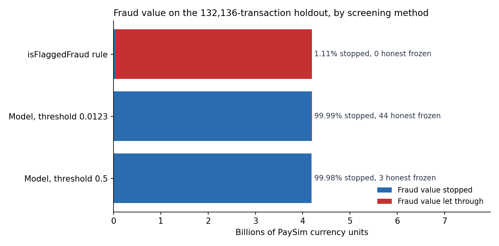
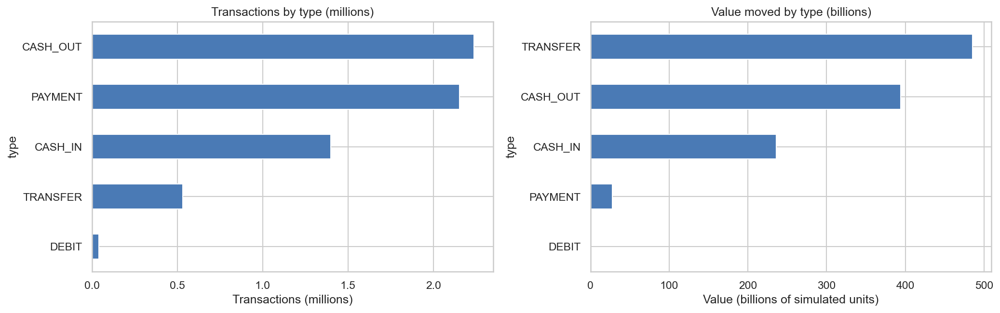
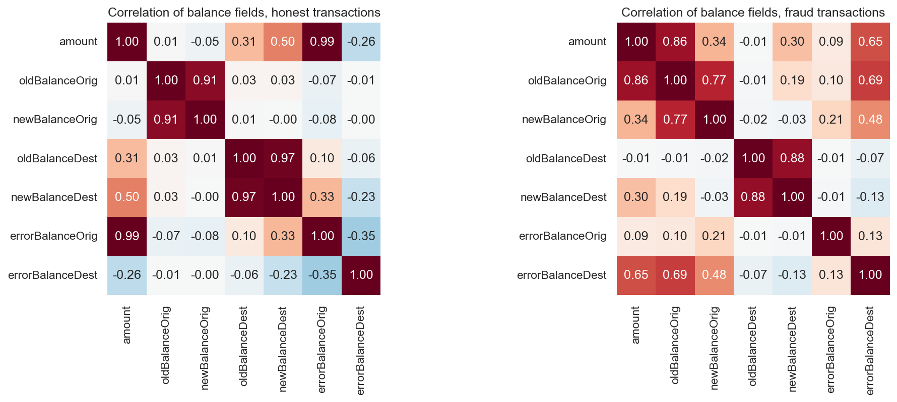
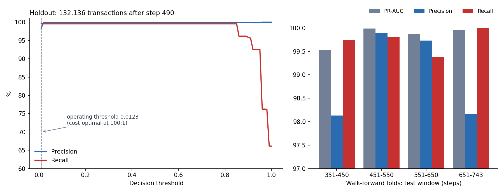

# Mobile-Money Fraud Detection

A model that flags fraudulent mobile-money transfers so a fraud team can freeze them, built and tested on 6.36 million simulated transactions.

[](LICENSE)
[](https://www.python.org/)
[](https://github.com/alvenyuka/Fraud-Detection-System/actions/workflows/ci.yml)



## What this project does

In mobile money, a fraud flag usually freezes the customer's funds. A false alarm locks a legitimate person out of
their own money. A missed fraud is a direct loss. So the question is: how much fraud can a model stop, how many
legitimate transfers does it freeze to do that, and does it keep working as time passes?

The data is PaySim, a public simulator built from the logs of a mobile-money service in Africa: 6,362,620
transactions over 743 simulated hours (about 31 days). It is simulated data, not customer transactions.

## Results

The model was fit on hours 1 to 392 and calibrated on hours 393 to 490 (calibration is explained in step 6). Everything
below, unless marked otherwise, is scored on the 132,136 TRANSFER and CASH_OUT transactions after hour 490, which the
model never saw. Of those, 2,754 are fraud.

- **It caught 2,742 of the 2,754 frauds (recall 99.6%).** Recall is the share of frauds the model flags.
- **It froze 3 honest transfers (precision 99.9%).** Precision is the share of flags that were real fraud.
- **It stopped 99.98% of the fraud value**, against 1.1% for the simulator's own built-in flag.
- **Ranking quality: PR-AUC 0.9984.** PR-AUC is the area under the precision-recall curve, the average precision
  across recall levels; a random model scores about the fraud rate, and 1.0 is perfect.
- **It held up over time: walk-forward PR-AUC 0.9971.** Walk-forward means retraining and re-testing on four
  successive later windows (step 8). It differs from 0.9984 because it averages four separate models on different
  test windows, not the one holdout. Precision averaged 96.9% over those windows and fell to 88.1% in the last. The
  ranking stayed good; the cut-off score that decides "flag or not" did not hold steady.
- **Live demo:** [fraud-detection-alven.vercel.app](https://fraud-detection-alven.vercel.app). Type in a transfer's
  amount and the sender and recipient balances before and after, and `api/score.py` returns the fraud probability and
  whether it is above the flag line. It runs the same model, ported to plain Python. Use it to poke at the model, not
  as fraud detection: see step 10 and Limits for how sensitive it is to the sender's balances.

| Measure on the holdout | Value | What it means |
|---|---:|---|
| Recall | 99.6% (2,742 of 2,754) | Frauds caught |
| Precision | 99.9% (3 false alarms) | Flags that were fraud |
| PR-AUC | 0.9984 | Area under the precision-recall curve; 1.0 is perfect |
| Brier score | 0.000131 | Average squared error of the predicted probabilities; 0 is perfect |
| Flag threshold | 0.8852 | Scores at or above this are flagged |
| Walk-forward PR-AUC (4 windows) | 0.9971 ± 0.0020 | Ranking holds in later windows |
| Walk-forward precision / recall | 96.9% / 99.7% | Averages over the 4 windows |

The holdout rows come from the metrics `src/train.py` stores inside `model/xgb_fraud_model.pkl` (run `make train`); the
walk-forward rows come from `dashboard/data/walk_forward_results.csv` (`make validate`).

Money on the same holdout, from `src/business_impact.py` (amounts are PaySim's simulated currency units, and a
fraud's value is its transaction amount):

| Screening | Fraud value stopped | Fraud value let through | Honest transfers frozen |
|---|---:|---:|---:|
| None | 0 | 4.19 bn | 0 |
| PaySim's built-in `isFlaggedFraud` flag | 46.5 M (1.1%) | 4.14 bn | 0 |
| **Model, threshold 0.8852** | **4.190 bn (99.98%)** | 0.75 M | 3 |
| Model, threshold 0.5 | 4.190 bn (99.98%) | 0.75 M | 3 |

The 3 honest transfers frozen were worth 0.31 M in total. The built-in flag caught 10 of the 2,754 frauds.

## How I built it

Each step adds one idea.

1. **Look at the data** (`Fraud_Detection_System.ipynb`, Part 1). PaySim has 6,362,620 transactions and 8,213
   are fraud, which is 0.13%. Fraud only happens in two transaction types, TRANSFER and CASH_OUT, which leaves
   2,770,409 rows to model. One pattern stands out: in 97.82% of frauds the amount equals the sender's whole
   balance, against 0.0% of legitimate transactions. The notebook's figures are in `figs/`, results in
   `outputs/notebook_results.json`. Accuracy is useless here: a model that flags nothing is right 99.87% of the
   time and stops no fraud, so I count frauds caught and honest transfers frozen instead.

   

   *Fraud appears only in TRANSFER and CASH_OUT, so the other three types are dropped.*

2. **A baseline: the simulator's own flag.** PaySim ships a rule-based flag, `isFlaggedFraud`. On the holdout it
   caught 10 of 2,754 frauds and stopped 1.1% of the fraud value (`src/business_impact.py`). Any model has to
   beat this.

3. **Features from bookkeeping.** A feature is a number the model gets to look at. A clean transfer obeys an
   accounting rule: the sender's balance falls by exactly the amount, and the recipient's rises by exactly the
   amount. Fraud often breaks it. `src/features.py` builds five numbers: the amount, how far the sender's
   balances miss the rule (`orig_balance_discrepancy`), how far the recipient's miss it
   (`dest_balance_discrepancy`), the share of the sender's balance the transfer moves (`orig_drain_ratio`),
   and the amount relative to the recipient's balance (`dest_amount_ratio`). The raw balance columns are left
   out on purpose, see "Problems I hit".

   

   *Drawn by the notebook from its own error columns (balance change minus amount). In honest transactions the
   sender error tracks the amount (correlation 0.99); in fraud it barely does (0.09). The shipped features
   measure the same kind of gap.*

4. **Split by time, not at random.** I train on hours 1 to 490 (steps 1 to 392 fit the model, 393 to 490 calibrate it) and test on 491 to 743 (`src/config.py`,
   `time_based_split` in `src/train.py`). Fraud patterns change over time, and a random split would let the
   model learn from the future. Among TRANSFER and CASH_OUT, the holdout fraud rate is 2.08% against 0.21% in training, so the test period has far more fraud.

5. **XGBoost, tuned.** XGBoost builds many small decision trees, each correcting the last one's mistakes.
   `src/tune.py` ran 40 trials with Optuna, a tool that searches settings automatically. I scored the trials only
   on windows ending by hour 350, so none of the hours I report on were used to pick the settings. Early
   stopping (stop adding trees once a held-back slice stops improving) kept 35 trees (`model/best_params.json`).

6. **Calibration.** A raw model score is a ranking, not a probability. Isotonic calibration fits a step-shaped
   curve that maps scores to the fraud frequency seen. I fit it on the latest fifth of the training
   hours (393 to 490), rows the model had not trained on, in `src/train.py`.

7. **Pick the threshold from money.** The threshold is the score above which a transaction is flagged. A missed
   fraud costs far more than a false alarm, so `pick_best_threshold` in `src/features.py` tries every cut-off
   and keeps the cheapest, pricing a missed fraud at 100 times a false alarm. That 100 is my assumption, not a
   measured cost. It uses the calibration hours, never the test rows, and gave 0.8852. Any cut-off from 0.5 up
   to 0.8852 gives the same result on the holdout (2,742 caught, 3 frozen), because the calibrated model gives only a few
   distinct scores. `src/scenarios.py` also probes the model with made-up transfers
   (`dashboard/data/scenario_table.json`). In that test a transfer that moves 99% of an account scores 0%, and
   one that moves 100% scores 90.2%.

   

   *Left: the holdout result is flat across a wide band of thresholds. Right: across later windows, ranking
   stays near 0.997 PR-AUC while precision moves.*

8. **Check over later windows (walk-forward).** Walk-forward validation repeats the whole train, calibrate and
   test cycle over successive later periods, each time training only on earlier data. `src/validate.py` runs
   four, testing hours 351 to 450, 451 to 550, 551 to 650 and 651 to 743, each picking its own threshold on its
   own calibration data. Ranking held (PR-AUC 0.9971), but the best threshold moved from 1.0 to 0.8182, 0.9855
   and 0.021 (`dashboard/data/walk_forward_results.csv`), and the last window's low threshold gave 88.1%
   precision against 99.6% to 100% in the other three.

9. **Watch for drift (PSI).** `src/monitoring.py` compares each feature's spread in a new window with the
   training window. PSI (Population Stability Index) below 0.10 is stable, and 0.25 or more means investigate.
   In hours 701 to 743 `orig_drain_ratio` reached 0.76 and `dest_amount_ratio` 0.26
   (`dashboard/data/psi_timeline.csv`). The monitoring runs on PaySim's own later hours, not on live traffic.

10. **Explain the scores.** SHAP is a method that splits each score into how much each input pushed it up or
    down. `src/explain.py` gives the shares in `dashboard/data/feature_importance.json`: `orig_balance_discrepancy`
    51.78%, `orig_drain_ratio` 25.08%, `dest_amount_ratio` 14.74%, `amount` 4.48%,
    `dest_balance_discrepancy` 3.93%. The first two carry 77% of the attribution, so small changes to the
    sender's balances can swing the score a lot.

11. **Export for the live API.** The web function cannot load the full XGBoost and scikit-learn stack.
    `src/export_model_json.py` writes the trees and the calibration curve to `model/model_export.json`, and
    `api/score.py` re-implements the scoring with only Python's standard library. `tests/test_export_parity.py` generates 20,000 random transactions, scores them through both, and checks they
    agree (worst gap about 6.6e-08, as recorded in `api/score.py`).

## Problems I hit

- **A shortcut through the balance columns.** The first model got the raw balance columns, and testing the live
  dashboard showed it scoring a 12-unit account that moved all 12 units to a recipient who was credited correctly as
  100% fraud. Fraud in PaySim nearly always empties the sender, so the model learned "balance hit zero". I
  removed the raw columns (commit 7bda93d) and `tests/test_features.py` guards it.
- **The shortcut came back through `orig_drain_ratio`.** Re-testing found that a transfer moving 100% of the
  balance scores 90.2% while one moving 99% scores 0.0000%. In PaySim, fraud almost always moves exactly 100%
  and legitimate transactions almost never do, so the label itself is the shortcut. Dropping columns cannot fix it,
  and `MODEL_CARD.md` says so. It is not solved: the 12-unit full-drain case from the first problem still scores
  0.8852, exactly the flag threshold (`small_full_drain` in `dashboard/data/scenario_table.json`), so it is
  flagged only because scores at the threshold count as flags. Real data with account closures would need retraining.
- **Tuning windows overlapped reporting windows.** Two of the three tuning windows were walk-forward windows, and
  part of the holdout sat inside the third, so those results were optimistic. Found when I audited the code (commit 6444c5d), fixed
  by tuning only on windows ending by hour 350 (commit 1588a10), then re-tuned and retrained (commit 5e55aa0).
  `tests/test_pipeline_guards.py` checks it.
- **The walk-forward threshold was chosen on the test rows.** `src/validate.py` picked each window's cut-off using
  that window's own answers, which pushed recall to exactly 1.0 in three of four windows. It now picks on calibration data. The same
  test file guards it. Fixing both leaks together and re-tuning moved holdout precision from 99.85% to 98.42%. The
  2026-10-02 retrain (35 trees, calibration on the latest 20% of training steps) moved it to 99.89% (`MODEL_CARD.md`).
- **A rule to catch partial fraud made things worse.** Scenario tests before deployment (`src/scenarios.py`) showed the
  model scores a fraud that moves half an account, with nothing credited to the recipient, at 0.0000%. I tried a rule on top that flags transactions where the
  recipient got far less than sent. On the larger training period it multiplied false alarms and raised cost. I dropped it. The
  script that measured this was not kept, so no figures are quoted (`MODEL_CARD.md`).

## Data

| Source | Terms | Size | Period |
|---|---|---:|---|
| [PaySim, Lopez-Rojas, Elmir and Axelsson (2016)](https://www.kaggle.com/datasets/ealaxi/paysim1) on Kaggle | Kaggle dataset licence | 6,362,620 transactions | 743 simulated hours |

Fraud is 0.13% of all 6,362,620 transactions. Among TRANSFER and CASH_OUT only, the types the model scores, it is 0.21% in the training period and 2.08% in the holdout (132,136 transactions). The CSV is not
committed; download it into `data/`.

## Limits

- **PaySim is a simulator.** Once these features exist its fraud is nearly deterministic, which is why the scores
  are so high. In the notebook a random forest reaches a PR-AUC of 1.0000. The method carries over to real data. The scores do not.
- **The model detects full drains of the sender's account, nothing broader.** A fraud that skims part of an
  account scores near 0%, the same as an ordinary transaction.
- **The holdout is fraud-heavy** (2.08% against 0.30% for TRANSFER and CASH_OUT over the whole simulation). At
  that whole-simulation rate the model would raise about 23 false alarms per million transactions and keep 99.2%
  precision (`business_impact.json`).
- **One fixed threshold.** The best cut-off moved a lot between windows (0.021 to 1.0), so a deployment would
  review it on a schedule.
- **Money figures are simulated units**, and the 100:1 cost ratio is an assumption.
- **The live demo** reflects the model above. It loads `model/model_export.json` from the main branch, so
  pushing a new export changes its scores.

## How to run

Python 3.12 or later. Main libraries: pandas, XGBoost, scikit-learn, Optuna, SHAP.

```bash
pip install -r requirements.txt   # exact pins; requirements-lock.txt pins everything
make test        # 63 tests, no dataset needed
# download PaySim from Kaggle into data/, then:
make tune        # 40 Optuna trials; the recorded run took 4 hours on a shared machine
make train       # train, save model/xgb_fraud_model.pkl and print the holdout metrics, about a minute
make validate    # four walk-forward windows -> walk_forward_results.csv and other dashboard/data files
make monitor     # PSI drift check -> dashboard/data/psi_timeline.csv
make explain     # SHAP shares -> dashboard/data/feature_importance.json
make scenarios   # made-up transfers -> dashboard/data/scenario_table.json (needs only the saved model)
python src/business_impact.py --data data/PS_20174392719_1491204439457_log.csv   # business_impact.json and fraud_value_stopped.png
make figures     # redraw figures/threshold_tradeoff.png only (reads dashboard/data)
```

## Project structure

```
src/            features, tuning, training, walk-forward validation, monitoring, SHAP, scenarios,
                business_impact.py (value stopped by each screen), make_figures.py
api/score.py    standard-library port of the model behind the live demo
dashboard/      Streamlit dashboard and the precomputed results it reads
model/          trained model, tuned settings, JSON export
tests/          63 tests: time split, the two fixed leaks, accounting identity, threshold, PSI, API, port parity
MODEL_CARD.md   intended use, evaluation, limitations
docs/           METHODOLOGY.md: tuning, walk-forward details, drift findings
Fraud_Detection_System.ipynb   data exploration and model comparison; its scores come from its own
                               wider feature set, not the shipped model
```

## License

MIT. See [`LICENSE`](LICENSE). Data: Lopez-Rojas, Elmir and Axelsson (2016), *PaySim: A financial mobile money simulator for fraud detection* ([Kaggle](https://www.kaggle.com/datasets/ealaxi/paysim1)).

Alven Yuka · [LinkedIn](https://www.linkedin.com/in/alven-yuka-610b78174/) · [Email](mailto:alvenyuka2@gmail.com)
